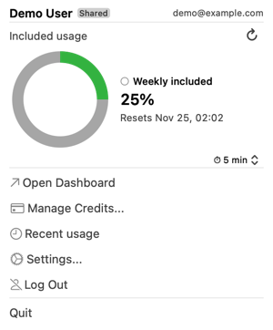
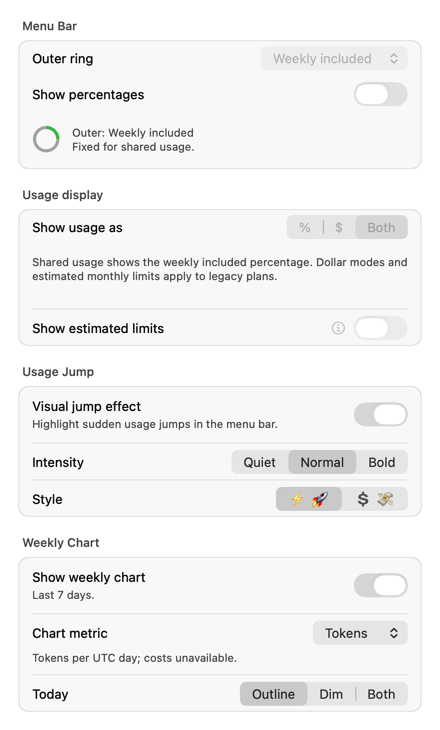

# Shared weekly usage and prepaid credit

Issue: [#147](https://github.com/WoojinAhn/CursorMeter/issues/147). Source baseline: `efe90d025408b35e2d32dcd15d25bf9db7e3ec3a`. Status: dual-meter direction accepted. Live read-only Cursor DashboardService requests work with the existing Cursor authentication; the reviewed API client and models are implemented at `6f8b1a5`. Session integration is committed at `81bf6f4`; native UI integration and bounded corrections are implemented and tested. Installed-app acceptance remains pending. Cross-review coverage and limitations are recorded below and in the [native integration plan](superpowers/plans/2026-11-17-issue-147-native-integration.md).

## Current zero-balance behavior (#150)

The [#150 preview](mockup-150.html) supersedes the original empty-wallet presentation below. A current verified zero prepaid balance uses only the weekly ring and reading, regardless of purchase history. Prepaid text, secondary percentages, tooltip/accessibility content and Display previews are omitted together. No no-purchases or exhausted-credit message replaces them. Manage Credits remains available for funding. Positive credit restores the prepaid meter; unknown/stale credit is never treated as confirmed zero. Independently meaningful monthly paid usage/cap and enabled automatic top-up remain visible.

## Task and presentation

A person checks the menu bar to understand remaining included capacity and prepaid credit, then opens the popover to distinguish weekly exhaustion, an empty wallet, and a reached monthly paid cap. The popover provides direct navigation to the official usage and billing pages. It never purchases credit or changes billing settings.

The [before/after mockup](mockup-147.html) preserves the existing 300 pt AppKit popover, 112 pt left dual meter, right-side labels/readings, compact system typography, refresh control, chart position, reset/interval row, and all existing action rows. The outer ring shows shared weekly consumption; the existing inner filled-circle meter shows prepaid credit consumption. Right-side readings show both percentages and the remaining balance / total purchased credit. Two compact rows below the meter show paid usage/cap and Auto Top-up/monthly reset. A Manage Credits action opens billing. The committed legacy screenshot remains the visual reference.

Menu-bar text follows the existing preference; this feature does not automatically append wallet amounts. When prepaid credit is shown, its icon retains both readings with the same outer/inner mapping; current zero balance retains only the weekly reading. Each meter always retains its meaning; exhaustion does not silently change the mapping. Product-level breakdown is secondary. Preserve the existing history-chart presentation and unavailable behavior; the mockup's synthetic history is a layout fixture, not proof of new-plan history support.

Visual changes are limited to those required by the billing model. Do not move numeric readings into the ring, add large billing sections, change typography or spacing globally, remove existing actions, or redesign the app shell.

## Prepaid credit meter

For purchased credit with a reconciled balance, consumption is `(totalPurchased - remainingBalance) / totalPurchased`. Both meters increase with consumption. The credit denominator is cumulative actual credit added to the same wallet, not this month's paid usage cap or the latest single top-up.

Example: $20 purchased and $12.40 remaining gives 38% consumed. Adding $20 changes the total to $40 and the balance to $32.40, giving 19% consumed. This expected reduction is useful feedback that capacity was replenished, not a reason to remove the meter. Weekly consumption and monthly paid spend/cap remain unchanged.

Current confirmed zero balance hides the prepaid meter, including never-funded and exhausted wallets. An unknown total with a positive balance keeps the balance visible with an unavailable percentage; stale or unavailable credit retains its distinct status. Do not substitute a monthly cap or infer missing purchase history from a single observed top-up. Purchased balances must reconcile with the purchase total; grants, refunds and expiry need explicit ledger treatment before labeling a balance reduction as consumption.

## Billing semantics

- Eligible first-party usage draws from weekly included usage first, then prepaid credit. Third-party Cursor models can draw from prepaid credit while included usage remains.
- The monthly additional-usage cap counts paid usage consumed, not purchased credit. It can stop paid usage with a positive wallet. Included weekly usage can remain available.
- A top-up increases remaining credit and total purchased credit, recalculating only the prepaid meter. Weekly and monthly resets have independent periods and do not refill or erase the wallet or reset the purchase total.
- Auto Top-up is a read-only setting. On does not prove payment success or guarantee uninterrupted usage.
- Missing, explicit zero, explicit no-cap, stale, and malformed values are distinct. A missing field is never converted to an available allowance.
- Keep paid spend, balance, and cap scoped to the same verified identity/workspace. Do not combine a seat's quota with another workspace's wallet. Team support needs explicit scope labeling and live evidence.
- Purchased credit and promotional grants are separate concepts. Any supported grant display must preserve eligibility and expiry; do not count an unverified grant as usable cash.

## Data source and coverage

The native adapter uses Cursor's `api2.cursor.sh` DashboardService with the existing Cursor credential. `GetPlanInfo` identifies the shared weekly plan; `GetCurrentPeriodUsage` supplies its total percentage and matching weekly period. `GetUserPrepaidBilling` supplies the wallet and optional monthly spending, and `GetHardLimit` supplies the paid usage cap. All four read-only methods succeeded with the existing IDE credential. No separate Grok login is required. See [API Reference](API_REFERENCE.md) for the wire contracts and their limits.

The prepaid top-up array is limited history. A purchased-credit ratio requires both a reconciled funded/spent/available equation and succeeded purchase records that account for the funded amount. Only the observed manual-purchase origin is recognized. Partial history, unknown origins, grants, refunds, or inconsistent amounts preserve the independently available balance but leave the ratio unavailable. Canonical protobuf Int64 strings are exact; compatibility with numeric JSON is bounded by Foundation Decimal precision.

### Earlier consumer-ledger investigation

The official CLI source uses `/v1/billing?format=credits` and exposes candidate `creditUsagePercent`, `currentPeriod`, `prepaidBalance`, `onDemandUsed` and `onDemandCap` fields. This does not prove those fields share the proposed monthly period on every unified account. The dashboard's `grok_api_v2.GrokBuildBilling/ListPrepaidBalanceChanges` route and protobuf schema have now been observed. Its `total` is the current balance with the opposite sign, not cumulative purchased credit. Entries distinguish successful/pending/failed purchases, automatic purchases, spend, refunds and adjustments. The request has no pagination parameters; the UI slices 20 rows after receiving the response. Actual posted-credit parity and server history-retention guarantees remain unverified. Verify actual credit posted rather than summing subscription charges or tax-inclusive invoices. Keep only sanitized fixtures and aggregate equality checks; never publish real credentials, account identifiers or billing values.

Validate a new-plan account with prepaid credit and a configured cap, a no-cap account, and zero/unknown variants. If a field cannot be validated, expose it as unavailable instead of claiming full billing coverage. A successful weekly reading alone does not satisfy #147.

## Selected verification scenarios

The mockup contains included-only, included-plus-credit, exhausted-weekly, reached-cap with included usage, both limits exhausted, empty-wallet, Auto Top-up enabled, explicit no-cap, partial data, unknown purchase total and stale data. Its synthetic transition controls demonstrate top-up, weekly reset and monthly reset independently. Verify 38% to 19% on the example top-up, hidden current-zero credit, restoration after funding, unknown/stale credit, and a functioning positive-credit meter with no monthly cap. The original #147 mockup records the earlier no-purchase/exhausted presentation; #150 supersedes it for current zero balance.

Native acceptance must check menu/popover semantics, keyboard navigation and dashboard destinations through native accessibility. Browser verification of this HTML proves only the proposal's rendering and synthetic interactions; it does not prove native app behavior or billing behavior.

## Verification

Playwright MCP verified the 300 px popover, 112 px dual meter, and all retained action rows. The initial 12 synthetic scenarios fit without horizontal overflow; the independent Grok review prompted separation of no purchases from an explicit zero cap, producing 13 scenarios that also fit. Follow-up checks verified dashed unknown weekly tracks, distinct no-purchase/exhausted copy and accurate unknown-total top-up copy. Checks also passed for the 38% to 19% top-up transition, independent weekly/monthly resets, neutral no-purchase state, fully consumed credit, unknown purchase total, no-cap credit percentage, and a reached cap that remains reached after a top-up. No JavaScript errors occurred. Light and dark-cap screenshots were visually inspected. Native 10/11 pt metadata follows the incumbent UI rather than a web body-text floor. Browser checks cover only synthetic rendering and transitions, not native implementation or authenticated API parity.

An authenticated CLI-proxy billing request returned HTTP 200 with weekly percentage/period and prepaid-balance fields. A separate auto-topup-rule request returned HTTP 200 with an empty object, which remains unknown. This establishes transport availability for the tested account, not cumulative-purchase history, paid-cap semantics, or parity for accounts with purchased credit. No real billing amounts or credentials are stored in this document.

Native Chrome DevTools subsequently observed a successful empty consumer-ledger response and the public protobuf descriptor. The corresponding direct Grok CLI-bearer request returned HTTP 403. That result concerns the earlier consumer transport, which is not used by the native adapter. At that stage, the purchased-credit model passed 12 focused tests and the weekly/paid-cap model passed 20, with 1,139 full-suite tests passing. These results cover pure logic only. The [ledger decoding plan](superpowers/plans/2026-11-16-issue-147-ledger-decoding.md) records the subsequent decoder stage.

The raw ledger decoder subsequently passed 26 focused tests and full regression reached 1,165 tests with zero failures. Independent specification and Argon High/Grok XHigh quality reviews passed. The decoder preserves signed amounts, missing versus zero messages and unknown statuses, validates bounded gRPC/protobuf input, and merges repeated singular embedded messages. It is retained as an independently tested decoder, not the native adapter's authentication path.

The Cursor DashboardService adapter passed independent specification and quality review. Coordinator verification ran 44 focused tests with zero failures after the final corrections. Live source verification established the existing-auth route; those network observations and fixture-based tests do not establish completed native integration.

## References

- [Usage and limits](https://cursor.com/help/models-and-usage/usage-limits)
- [Prepaid balance and automatic top-ups](https://docs.x.ai/x-subscription/prepaid-balance)
- [Managing The X Subscription and top-up invoices](https://docs.x.ai/x-subscription/manage)
- [Spend limits](https://cursor.com/help/account-and-billing/spend-limits)
- [Official Grok CLI billing source](https://github.com/xai-org/grok-build/blob/main/crates/codegen/xai-grok-shell/src/extensions/billing.rs)

## Existing-login integration decision (2026-11-17)

The user explicitly retained CursorMeter's existing Cursor IDE connection and
browser-login fallback. Read-only API2 DashboardService calls using that same
Cursor access token returned plan detection, the shared weekly period/percentage,
prepaid balance and succeeded top-ups, and the monthly cap. No separate Grok
login or retained WebView is part of the implementation. The earlier direct Grok
CLI bearer failure only applies to that different consumer transport.

The [native integration plan](superpowers/plans/2026-11-17-issue-147-native-integration.md)
keeps shared readings in separate state while retaining the existing session
ownership and layout. The response top-up array is limited history, so it is
reconciliation evidence rather than an unconditional cumulative denominator.
The current authenticated source can still supply a balance when history or
aggregate semantics do not support a purchased-credit percentage.

## Native integration verification

The existing-session controller and native UI passed separate specification and quality reviews. The final full regression passed 1,247 tests with zero failures. Synthetic native AppKit captures cover the normal weekly/prepaid layout, stale/unknown values, exhaustion/cap states, no purchases, and Display/Alerts/Usage settings. Light and dark captures were visually inspected. The six committed shared-plan screenshots use synthetic identity and billing examples. These captures do not establish installed-app authentication or real-account parity.

Argon High approved the full native candidate before the bounded corrections. Grok XHigh identified explicit unsupported membership transitions, the neutral no-purchase track, a missed Settings preview caller, and missing positive ring-stroke test coverage. These findings were corrected with failing-to-passing regression tests. The renderer call-site audit covers the status item, popover, Settings preview, and unchanged legacy wrapper. Both external reviews were static; neither ran tests or validated the installed app. Existing Cursor authentication remains unchanged.

Before #150, the no-purchase inner meter was a solid, unfilled neutral circle, while an unknown purchase total remained dashed. The current zero-balance screenshots below reflect #150's single weekly meter; the rest of this paragraph records the original verification. Settings preview parity is tested with percentages on/off in both appearances; the empty center and ring stroke are tested at both meter sizes. Independent native specification and quality reviews cover the bounded follow-ups. Argon High correction review ended without an answer after a `read_file` permission denial; this is not counted as a pass or retried with broader permissions. The final wiring correction was validated locally; final external-model approval of that correction is not claimed.

The initial development artifact was packaged with strict signature and executable-hash checks, then installed after backing up the existing app and local settings/cache. Its first startup waited for macOS Keychain access in the existing credential-read path. No credential was deleted and no access controls were changed. That observation did not establish installed-app acceptance.

On 2026-11-18, the user supplied a logged-in native screen showing Unsupported.
Fresh authenticated API reads succeeded, but the actual membership was `premium`;
the personal-scope gate only recognized legacy plan names and prevented the
weekly/wallet refresh. Synthetic success fixtures had used `pro`, so the previous
tests did not cover the real new-plan trigger. The correction adds the four exact
current membership tokens verified in the official Cursor client, retains the
team/unknown/owner boundaries, and uses `premium` in shared UI fixtures. The new
regressions failed before the fix, and the full suite now passes 1,250 tests.
The installed development build `8997357` was verified separately from tests.
The displayed account matched a fresh authenticated primary profile, the badge
was Shared, and the native weekly percentage/reset, remaining/purchased credit,
monthly paid usage and cap matched fresh DashboardService responses. Pressing the
native Refresh usage control reported Updated and retained those readings. The
capture was driven by the popover's accessibility frame and its matching native
window; identity was cropped, and real billing values remain in private evidence.
In that build, an omitted Auto Top-up rule still displayed Unknown and shared
activity history remained unavailable. These were distinct from the repaired
unsupported-plan error; [#148's capability restoration](design-148-shared-capabilities.md)
tracks their subsequent source verification and integration.
Independent specification review and fresh Argon High/Grok XHigh quality reviews
approved the bounded correction. The two external reviews used a self-contained
source packet without tools; neither executed tests nor observed the installed app.
